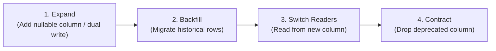

# Database Migration Policy & Zero-Downtime Guidelines

> **Reference for**: `.agents/skills/db-migration/SKILL.md`

---

## The Expand and Contract Pattern

When modifying database schemas in live systems, never perform breaking changes in a single deployment. Always split changes across multiple releases:

### 1. Adding Columns
- **Rule**: New columns must be either `NULLABLE` or have a database-level `DEFAULT` value.
- **Why**: Existing application instances will insert rows without knowing about the new column during deployment rolling updates.

### 2. Renaming Columns
- Never use `ALTER TABLE ... RENAME COLUMN`.
- **Procedure**:
  1. Add the new column name (nullable).
  2. Write code that writes to both old and new columns.
  3. Backfill old rows into the new column.
  4. Update application reads to use the new column.
  5. Remove writes to the old column.
  6. Drop the old column in a subsequent release.

### 3. Adding Indexes on Production Tables
- In PostgreSQL, always use `CREATE INDEX CONCURRENTLY` to avoid taking a table-exclusive write lock.
- In MySQL, verify that `ALGORITHM=INPLACE, LOCK=NONE` is supported for the operation.
