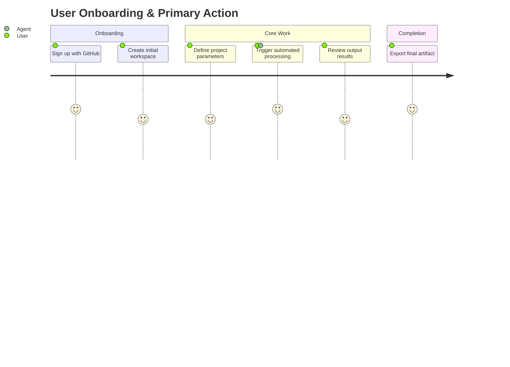

# Product Requirements Document (PRD)

> **Document Status**: Draft / In Review / Approved  
> **Author**: Product Manager / Founder  
> **Last Updated**: <!-- YYYY-MM-DD -->  
> **Target Release**: <!-- MVP / v1.0 -->

---

## 1. Executive Summary & Problem Statement

### 1.1 Problem Statement
<!-- Describe the specific customer or business pain point. Why does this product need to exist? -->
Users currently struggle with <!-- [Describe manual, painful, or fragmented existing workflow] -->. This leads to <!-- [negative outcome: lost time, high error rates, poor developer experience] -->.

### 1.2 Proposed Solution
<!-- High-level summary of the solution -->
Build <!-- [Product Name] -->, a <!-- [category/description] --> that provides <!-- [core value proposition] -->.

### 1.3 Target Audience & Personas
- **Primary Persona**: <!-- e.g., Senior Fullstack Engineer needing fast prototyping tools -->
- **Secondary Persona**: <!-- e.g., Engineering Lead needing visibility and safety guardrails -->

---

## 2. Goals & Success Metrics

### 2.1 Business Goals
1. Deliver a working MVP within <!-- [e.g. 4 weeks] -->.
2. Enable users to complete <!-- [core user task] --> in under <!-- [e.g. 3 minutes] -->.

### 2.2 Key Performance Indicators (KPIs)
| Metric | Baseline | Target |
| :--- | :--- | :--- |
| Core Task Completion Rate | 40% | > 85% |
| Average Task Duration | 15 mins | < 3 mins |
| User Error / Failure Rate | 25% | < 5% |

---

## 3. Scope & Feature Requirements

### 3.1 Prioritization Matrix
- **P0 (Must Have for MVP)**: Non-negotiable core workflows.
- **P1 (Should Have)**: Critical enhancements that enrich the experience.
- **P2 (Nice to Have)**: Post-launch optimizations or advanced settings.

### 3.2 User Stories & Features

#### [P0] Core Authentication & Workspace Setup
- **User Story**: *As a user, I want to sign up and establish a workspace so that my project data is secured and isolated.*
- **Requirements**:
  - Email/password and OAuth (GitHub/Google) authentication.
  - Workspace creation on first login.
  - Multi-tenant isolation enforced at the database level.

#### [P0] Primary Business Flow
- **User Story**: *As a user, I want to <!-- [describe main action] --> so that <!-- [value] -->.*
- **Requirements**:
  - Ability to create, read, update, and delete <!-- [core entity] -->.
  - Synchronous validation on input data with human-readable error messages.
  - Export or download output in standard formats (JSON, CSV, PDF).

#### [P1] Real-time Notifications & Audit Trail
- **User Story**: *As a user, I want to be notified when actions complete and view an activity log.*
- **Requirements**:
  - In-app toast notifications for asynchronous jobs.
  - Append-only audit log of critical changes.

---

## 4. Non-Goals (Explicit Out-of-Scope)

> [!IMPORTANT]
> Non-goals prevent agent scope creep and misaligned autonomous decisions.

- **Non-Goal 1**: No native mobile application for MVP (responsive web only).
- **Non-Goal 2**: No custom self-hosted enterprise deployment for v1.
- **Non-Goal 3**: No billing or subscription paywalls in early alpha.

---

## 5. User Journey & Acceptance Criteria

### Acceptance Criteria Checklist
- [ ] New user can register and reach the dashboard within 60 seconds.
- [ ] Core action succeeds with valid input and displays clear validation on invalid input.
- [ ] All sensitive actions (e.g. deletion) require explicit confirmation.
- [ ] 100% of user data remains scoped to their authenticated organization/workspace.

---

## 6. Open Questions & Assumptions

- *Assumption 1*: Target users have modern evergreen web browsers with JavaScript enabled.
- *Open Question 1*: Should default project templates be seeded automatically for all new users?
