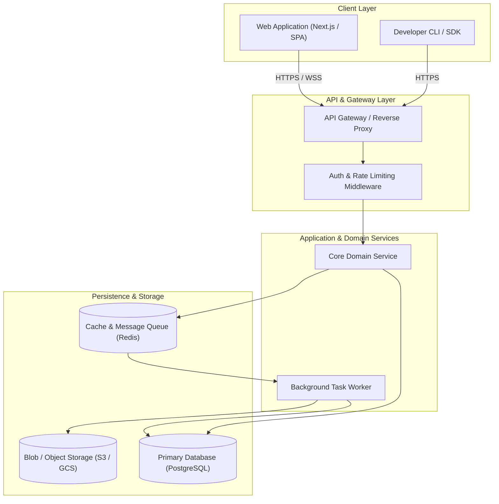
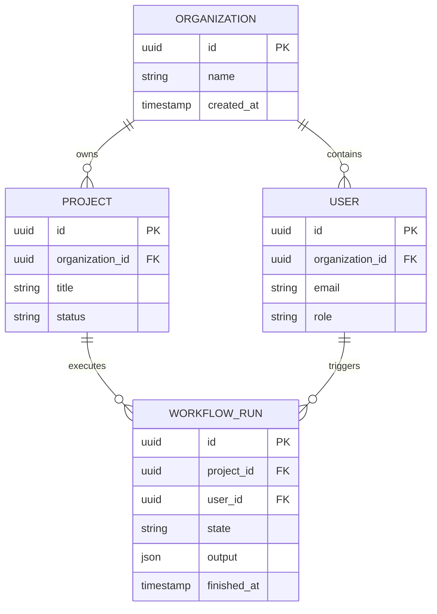

# Technical Architecture Specification (`spec.md`)

> **Document Status**: Draft / Approved  
> **Author**: Tech Lead  
> **Last Updated**: <!-- YYYY-MM-DD -->  
> **Companion PRD**: `@docs/prd.md`

---

## 1. System Overview & Architecture

### 1.1 High-Level Architecture Diagram



### 1.2 Core Architectural Principles
- **Hexagonal / Clean Architecture**: Core domain logic has zero dependencies on external frameworks or database drivers.
- **Stateless Application Servers**: All user state is preserved in persistent storage or session caches to enable horizontal scaling.
- **Fail-Safe & Fault-Tolerant**: Network boundaries use timeouts, retries with exponential backoff, and circuit breakers.

---

## 2. Layered Architecture & Boundary Rules

Code in this codebase follows strict inward-pointing dependencies:

```text
src/
├── presentation/     # HTTP controllers, route handlers, CLI commands
├── application/      # Use cases, application services, workflow orchestration
├── domain/           # Pure business logic, domain models, entity invariants
└── infrastructure/   # Database repositories, third-party clients, file system
```

### Dependency Rules
- **Rule 1 (Domain Isolation)**: The `domain/` layer must NEVER import from `infrastructure/` or `presentation/`.
- **Rule 2 (Presentation Boundary)**: The `presentation/` layer communicates with `application/` use cases, never directly querying infrastructure repositories.
- **Rule 3 (Dependency Inversion)**: External dependencies are inverted using interfaces/ports defined in `application/` or `domain/` and implemented in `infrastructure/`.

---

## 3. Component Breakdown & Responsibilities

| Component | Responsibility | Tech Stack | Inbound Interface |
| :--- | :--- | :--- | :--- |
| **Gateway / Route Handlers** | HTTP routing, authentication, request validation | Node.js / Express / Next.js | Public REST / GraphQL |
| **Domain Services** | Business rules, calculations, transaction orchestration | TypeScript / Python | Internal Service API |
| **Data Repositories** | Database access, entity mapping, query optimization | Prisma / SQLAlchemy | Internal Repository Methods |
| **Task Workers** | Asynchronous jobs, report generation, webhooks | BullMQ / Celery | Redis Queue Events |

---

## 4. Ubiquitous Language & Domain Models

### 4.1 Ubiquitous Language / Glossary

| Term | Definition | Invariant / Boundary |
| :--- | :--- | :--- |
| **Organization** | The top-level billing and governance tenant. | Every user and project belongs to exactly one Organization in MVP. |
| **Project** | A workspace container holding related workflow definitions and runs. | Cannot be deleted if active workflow runs are executing. |
| **Workflow Run** | A single execution instance of an automated process. | Immutable once completed or failed. |
| **Artifact** | A structured document or output produced by an agent or workflow. | Version-controlled and linked to a specific Workflow Run. |

### 4.2 Core Entities & Invariants

#### Project Entity
- **Attributes**: `id` (UUIDv4), `name` (1–100 chars, alphanumeric/hyphens), `status` (`DRAFT`, `ACTIVE`, `ARCHIVED`).
- **Invariants**:
  - A project cannot transition directly from `DRAFT` to `ARCHIVED` without reaching `ACTIVE`.
  - Archived projects are read-only.

#### Workflow Run Entity
- **Attributes**: `id` (UUIDv4), `projectId` (UUIDv4), `state` (`QUEUED`, `RUNNING`, `SUCCESS`, `FAILURE`, `CANCELLED`), `startedAt` (Timestamp), `completedAt` (Nullable Timestamp).
- **Invariants**:
  - `completedAt` must be greater than or equal to `startedAt`.
  - Only one active run per project may execute concurrently unless parallel execution is explicitly enabled.

---

## 5. Data Models, ERD & State Lifecycle

### 5.1 Entity Relationship Diagram



### 5.2 State Lifecycle (Example: `WORKFLOW_RUN`)
- `PENDING` → `RUNNING` → `COMPLETED` | `FAILED` | `CANCELLED`
- **Invariant**: A terminal state (`COMPLETED`, `FAILED`, `CANCELLED`) can never transition back to `PENDING` or `RUNNING`.

---

## 6. API Specifications & Contracts

### 6.1 Base Conventions
- All endpoints prefixed with `/api/v1/`.
- Strict JSON request and response payloads.
- Authentication via `Bearer <JWT>` in the `Authorization` header.

### 6.2 Core Endpoints (Sample)
```http
POST /api/v1/projects
Content-Type: application/json
Authorization: Bearer <token>

{
  "title": "My New Project",
  "description": "Project overview description"
}

Response (201 Created):
{
  "data": {
    "id": "proj_abc123",
    "title": "My New Project",
    "status": "ACTIVE",
    "createdAt": "2026-11-02T13:30:00Z"
  }
}
```

---

## 7. Security & Authentication Architecture

- **Token Strategy**: Short-lived JWT access tokens (15 minutes) paired with rotating refresh tokens stored in HTTP-only, Secure cookies.
- **Role-Based Access Control (RBAC)**:
  - `OWNER`: Full administrative and billing privileges.
  - `MEMBER`: Read/write access within assigned projects.
  - `VIEWER`: Read-only access.
- **Data Protection**: Sensitive columns encrypted at rest; TLS 1.3 enforced for all transport.

---

## 8. Observability & Logging

- **Structured Logging**: All logs emitted in JSON format containing `trace_id`, `user_id`, `timestamp`, and `level`.
- **Metrics**: Standard golden signals emitted via OpenTelemetry / Prometheus (latency, traffic, errors, saturation).
- **Error Tracking**: Unhandled exceptions forwarded to error monitoring (e.g. Sentry) with sanitized stack traces.

---

## 9. Testing Strategy & Harness Verification

To enable mechanical verification for agentic engineering, the project enforces three testing tiers:

1. **Unit Tests (`tests/unit/`)**: Fast, pure in-memory tests exercising business rules and edge cases (<50ms execution).
2. **Integration Tests (`tests/integration/`)**: Tests verifying interactions between services, database transactions, and repository queries using a test container.
3. **End-to-End Tests (`tests/e2e/`)**: Full-flow validation of HTTP endpoints or browser UI.

*Every bug reported must be preceded by a failing regression test before the fix is applied.*

---

## 10. Architecture Decision Records (ADRs)

When introducing major architectural changes or adopting new core libraries, record an ADR below:

### ADR-001: [Title of Architectural Decision]
- **Date**: YYYY-MM-DD
- **Status**: [Proposed | Accepted | Superseded]
- **Context**: Describe the context, forces, and problem that prompted this decision.
- **Decision**: State the architectural choice made.
- **Consequences**:
  - *Positive*: Benefits gained (e.g., performance, safety).
  - *Negative / Trade-offs*: Costs, operational complexity, or migration effort incurred.
